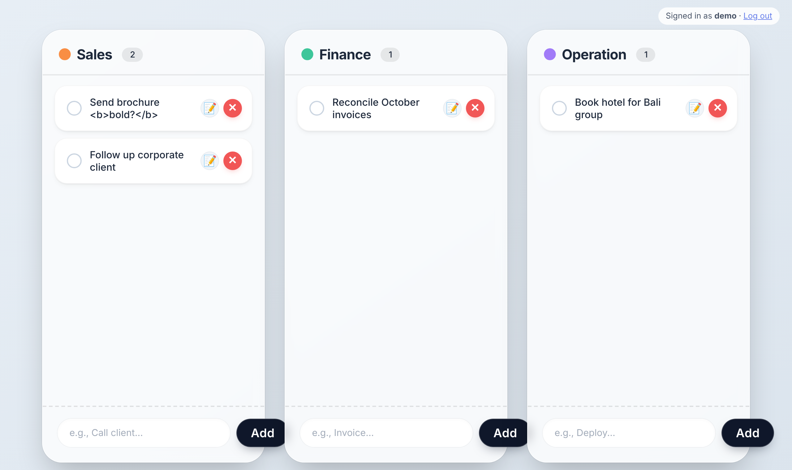

# Kanban Task Board

A team task board with three columns (Sales, Finance, Operation). Tasks can be dragged between columns, and each task has a description, a chat thread and file attachments.

**Stack:** PHP 8 (no framework), PDO, MySQL/MariaDB, vanilla JavaScript (Fetch API, HTML5 drag & drop)

## Features
- Login with hashed passwords (`password_hash`); every user only sees and edits their own tasks
- Drag & drop between columns; every move and rename is written to a `task_history` table
- Task detail page with description, chat messages and attachments
- File uploads: images and PDF up to 10 MB

## Security work (compared with my first version)
| Problem in the first version | Fix |
|---|---|
| Upload accepted any file type — a `.php` file could be uploaded and executed | Extension **and** real MIME type (from file content) must match a whitelist; files get random names; `uploads/` is not web-accessible and files are streamed through `download.php` after an ownership check |
| No authentication — `user_id` was hard-coded to `1` and sent by the browser | Session login; the user id comes from the session only |
| Any user could change or delete any task by UUID | Every query checks `user_id` |
| Debug info (`$_FILES`, SQL errors) returned to the browser | Generic error message, details only in the server log |
| Task titles inserted into the page with `innerHTML` (XSS) | Escaped before rendering |
| No CSRF protection | CSRF token required on every state-changing request |
| "Save Changes" crashed: the description field it read did not exist | Description field added |

## Run locally (XAMPP)
1. Copy this folder into `htdocs` and import `database/schema.mysql.sql` in phpMyAdmin.
2. Create a login: `php database/create_user.php demo demo1234`
3. Open `http://localhost/01-kanban-task-board/public/`

Database settings are in `config/config.php` (defaults: MySQL `root`, no password) and can be overridden with `DB_DSN`, `DB_USER`, `DB_PASS`.

## Tests
`bash tests/run_tests.sh` starts PHP's built-in server with a throwaway SQLite database and runs 30 end-to-end checks (auth, CSRF, ownership, upload filtering, cascade deletes).

## API
| Method | Endpoint | Description |
|---|---|---|
| GET / POST | `api/task.php` | List / create tasks |
| PUT / DELETE | `api/task.php?task_uuid=…` | Update (incl. move) / delete |
| GET | `api/get_messages.php?task_id=…` | Chat messages |
| POST | `api/send_message.php` | Send a message |
| GET | `api/get_attachments.php?task_id=…[&recent=5]` | List attachments |
| POST | `api/upload_attachment.php` | Upload files |
| POST | `api/delete_attachment.php` | Delete an attachment |
| GET | `api/download.php?id=…` | Download (owner only) |

## Limitations
- Tasks are private per user; there is no shared team board or user roles yet.
- `uploads/` is protected by `.htaccess` (Apache). On Nginx, add an equivalent `deny` rule.
