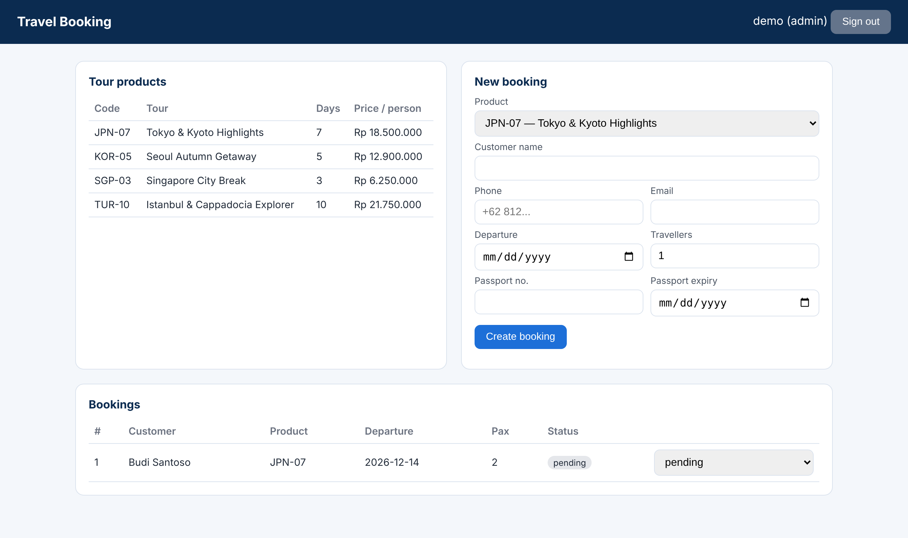

# Travel Booking REST API

A JSON REST API for a travel agency: staff log in, browse tour products, create bookings and update their status. Every booking also writes a ledger entry with a snapshot of the price, so later price changes never alter past records. A small HTML page (`public/index.html`) uses the API.



**Stack:** PHP 8 (no framework), PDO, MySQL/MariaDB. Layered structure: front controller → router → middleware → controllers → models.

```
public/index.php        front controller (all /api/* requests)
src/Core/               Router, Jwt (HS256), Database, Http helpers
src/Middleware/         AuthMiddleware (JWT + roles), RateLimitMiddleware
src/Controllers/        Auth, Product, Booking, Ledger
src/Models/             User, Product, Booking, Ledger
```

## Endpoints
| Method | Path | Auth | Description |
|---|---|---|---|
| POST | `/api/auth/login` | – | Returns a JWT (8 h) |
| POST | `/api/auth/register` | admin | Create a staff/admin account |
| GET | `/api/products` | staff | Active tour products |
| GET | `/api/products/{code}` | staff | One product |
| GET | `/api/bookings?status=&page=&per_page=` | staff | Paginated list |
| POST | `/api/bookings` | staff | Create booking + ledger entry (one transaction) |
| GET | `/api/bookings/{id}` | staff | Booking with ledger |
| PATCH | `/api/bookings/{id}/status` | staff | pending → confirmed → paid / cancelled |
| GET | `/api/ledger` | admin | All ledger entries |
| GET | `/api/ledger/summary` | admin | Bookings, travellers and revenue per product (cancelled excluded) |

Example:
```bash
TOKEN=$(curl -s -X POST localhost/02-travel-booking-api/public/api/auth/login \
  -H 'Content-Type: application/json' -d '{"username":"demo","password":"demo1234"}' | jq -r .token)
curl localhost/02-travel-booking-api/public/api/products -H "Authorization: Bearer $TOKEN"
```

## Business rules
- Passport must be valid at least **6 months after departure**; departure cannot be in the past.
- Inactive products cannot be booked; `pax` must be 1–50.
- Cancelled bookings are final.
- Validation errors return `422` with a message per field.

## What changed from my first version
| First version | Now |
|---|---|
| Table names contained a space (`"u976329373_themawisata buku_besar"`), so queries failed | Clean schema in `database/` |
| JWT secret hard-coded in the source | Read from the `JWT_SECRET` environment variable |
| Anyone could call `/auth/register` | Only admins can create accounts |
| Booking and ledger written separately | One database transaction |
| CORS open to every origin (`*`) | Only origins listed in `CORS_ORIGINS` |
| Routing broke depending on the folder name | Router works from any sub-folder |
| Rate limit counted per full URL (bypassed with a query string) | Counted per IP and route, with `Retry-After` header |
| Data tied to my employer's database | Generic schema and fictional sample data |

## Run locally (XAMPP)
1. Copy the folder into `htdocs`; import `database/schema.mysql.sql` and `database/seed.sql`.
2. `php database/create_user.php demo demo@example.com demo1234 admin`
3. Open `http://localhost/02-travel-booking-api/public/` (Apache `mod_rewrite` must be on).

## Tests
`bash tests/run_tests.sh` runs 40 end-to-end checks against PHP's built-in server and SQLite: JWT (tampered and expired tokens), roles, validation, transactions, ledger maths, pagination, CORS and rate limiting.

## Limitations
- The JWT implementation is minimal (HS256 only, no refresh tokens). In a larger project I would use `firebase/php-jwt`.
- The MySQL schema was written to match the SQLite one used in the tests, but the automated tests run on SQLite only.
