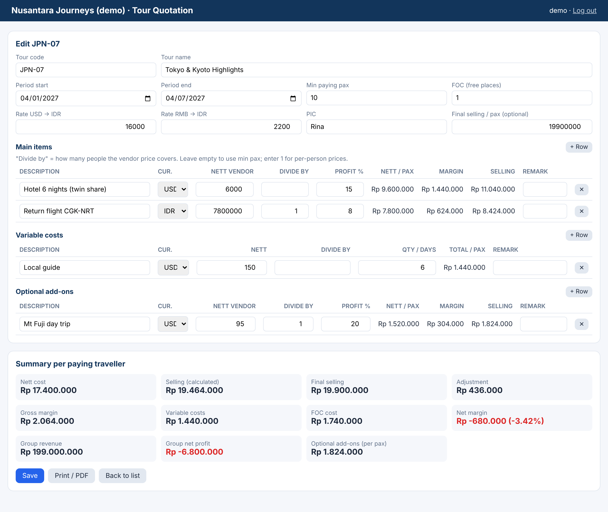

# Tour Quotation Generator

An internal tool for pricing group tours. Staff enter vendor costs in IDR, USD or RMB; the app calculates nett cost, margin and selling price per traveller, spreads free-of-charge places (e.g. a tour leader) over the paying group, and produces a customer-facing quotation for printing or saving as PDF.

**Stack:** PHP 8, PDO, MySQL/MariaDB, vanilla JavaScript

## How the price is calculated
All calculation happens in one PHP class, `src/QuotationCalculator.php`. It is used for the live preview and again when saving, so the browser can never send its own totals.

| Item type | Formula (per paying traveller) |
|---|---|
| Main item | nett = vendor price × exchange rate ÷ group size it covers; selling = nett + profit % |
| Variable cost (guide, bus…) | total = price × rate × days ÷ group size |
| Optional add-on | priced like a main item but **not** included in the package price |
| FOC cost | free places × total nett ÷ paying travellers |
| Net margin | gross margin − variable costs − FOC cost + (final price − calculated price) |

`tests/CalculatorTest.php` checks every figure against a hand-calculated example.

## Features
- Create, edit, search and delete quotations
- Live preview while typing; negative margins are highlighted
- Printable quotation for the customer that hides nett prices and margins
- Login with CSRF protection; all input validated server-side with per-field errors

## What changed from my first version
I had three overlapping versions of this tool. This one merges them and fixes:
- the list never loaded (the page called `get_quotations.php`, but the file was `get_quotation.php`);
- the server stored whatever totals the browser sent;
- FOC, minimum pax and exchange rates were not saved to the database;
- variable costs were divided by the group size twice in the margin calculation;
- `DELETE … WHERE tour_id = $tour_id` was built from request input (SQL injection) — all queries are now prepared statements;
- optional add-ons were added to the package total;
- the company name and data were hard-coded — now configurable (`COMPANY_NAME`) with fictional sample data.

## Run locally (XAMPP)
1. Copy the folder into `htdocs`; import `database/schema.mysql.sql`.
2. `php database/create_user.php demo demo1234`
3. Open `http://localhost/03-tour-quotation-generator/public/`

## Tests
`bash tests/run_tests.sh` — calculator unit test plus 22 end-to-end checks (validation, ignoring client totals, print output, cascade delete).

## Limitations
- PDF export uses the browser's "Save as PDF" (my earlier version used dompdf).
- Exchange rates are entered by hand per quotation.
