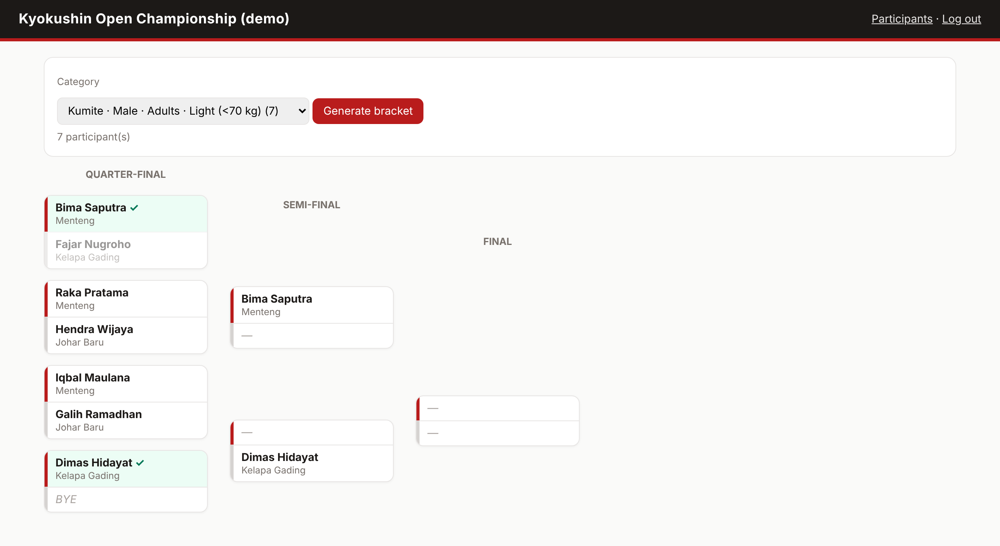

# Karate Tournament Bracket

A tool for running a Kyokushin karate tournament: organisers register fighters, the app sorts them into categories and builds single-elimination brackets, and results are recorded by clicking the winner. Spectators can follow the brackets without logging in.

**Stack:** PHP 8, PDO, MySQL/MariaDB, vanilla JavaScript

## How categories and brackets work
- **Category** = event (kumite or kata) + sex + age group on the tournament date (children < 13, juniors 13–17, adults 18+). Kumite is also split by weight (< 70, 70–80, > 80 kg); kata is not, because it is judged on form.
- **Bracket size** is the next power of two; the missing places become byes, and a fighter with a bye moves to round 2 automatically.
- **Club-mates meet as late as possible.** The bracket is split in halves again and again, and each dojo's fighters are divided evenly over both halves (`src/BracketEngine.php`).
- **Results:** clicking a fighter records the win and moves them to the next round. A result can be corrected until the next round is played; rebuilding a bracket that already has results needs confirmation.

## What changed from my first version
| First version | Now |
|---|---|
| Registration built SQL from `$_POST` directly (SQL injection) | Prepared statements and server-side validation |
| The form saved to table `karate_member`, but the bracket read from `players` | One `participants` table |
| Brackets were shuffled randomly in the browser and lost on refresh | Brackets and results stored in the database |
| Same-dojo rule only paired neighbours; leftovers fought "(????)" | Proper bracket with byes and dojo separation in every round |
| No login: anyone could change data | Organiser login + CSRF; public read-only view without private data (birth date, weight) |

## Run locally (XAMPP)
1. Copy the folder into `htdocs`; import `database/schema.mysql.sql` (and `database/seed.sql` for fictional demo fighters).
2. `php database/create_user.php panitia secret123`
3. Open `http://localhost/04-karate-tournament-bracket/public/`

Tournament name and date are set in `config/config.php` or with `TOURNAMENT_NAME` / `TOURNAMENT_DATE`.

## Tests
`bash tests/run_tests.sh` — bracket engine unit tests (byes, dojo separation, every fighter placed once) plus 31 end-to-end checks (permissions, validation, advancing winners, locking, byes).

## Limitations
- Single elimination only (no repechage or third-place match).
- Weight and age limits are fixed in code; real federations use more classes.
